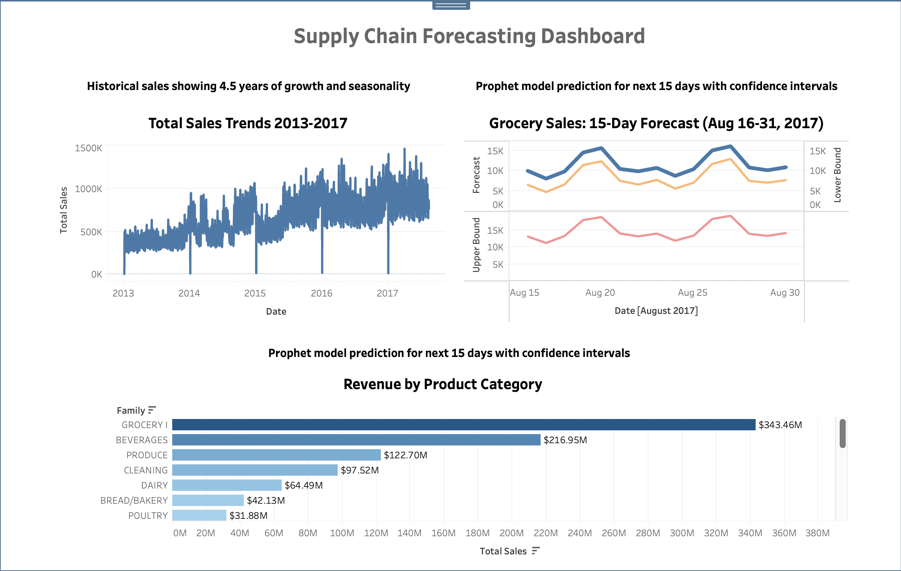
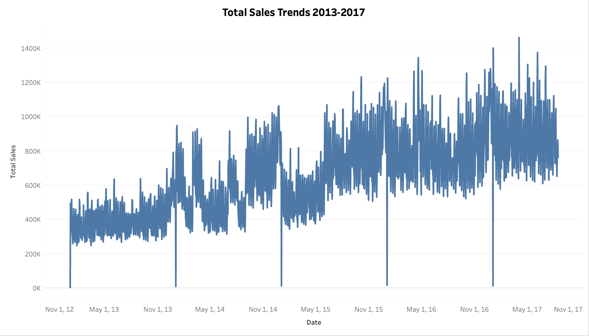
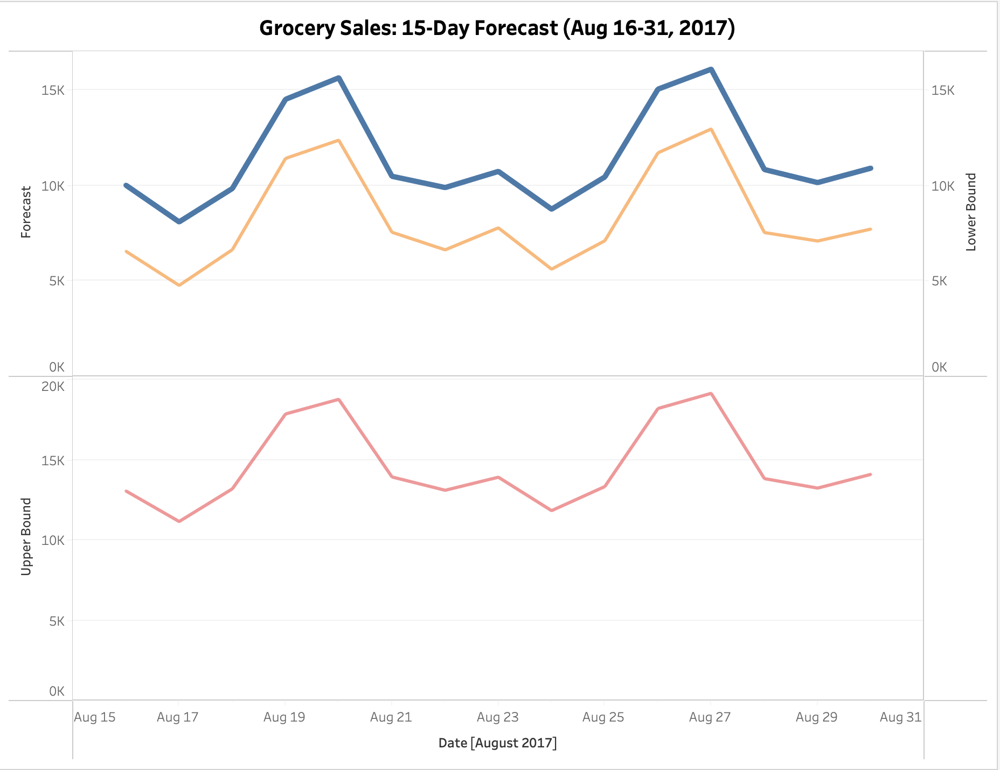
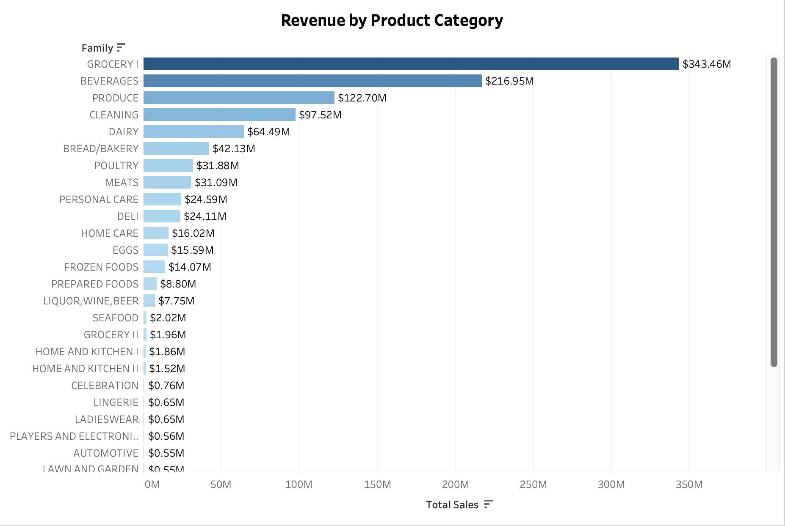
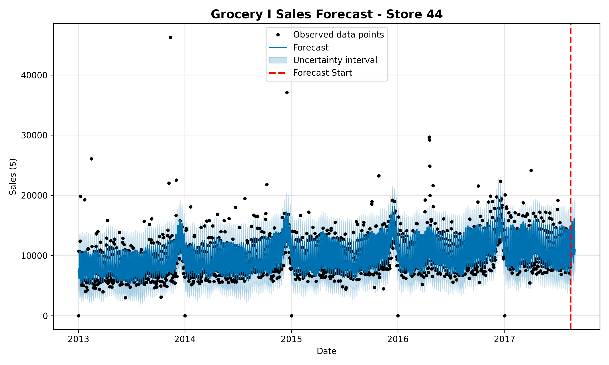
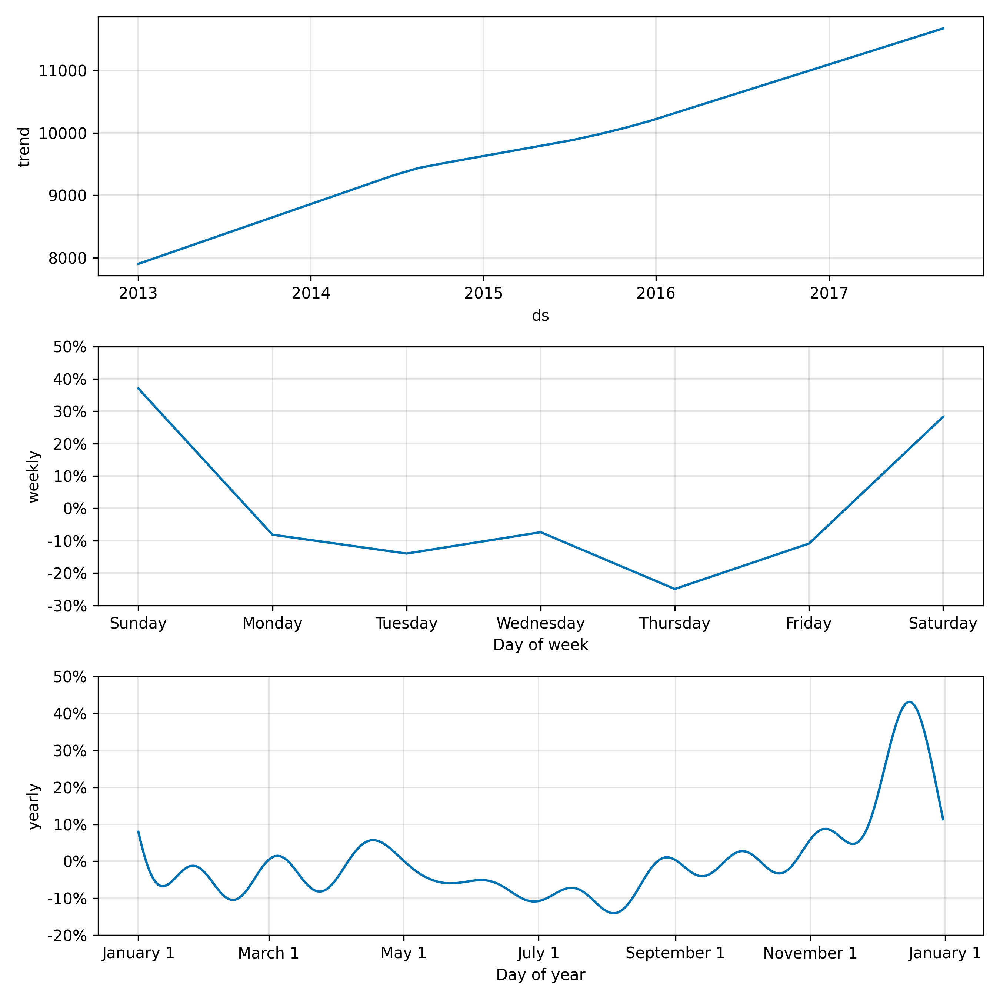

# Supply Chain Demand Forecasting and Inventory Planning

Daily demand forecasting for Corporación Favorita, an Ecuadorian grocery chain, using 3,000,888 sales records from 54 stores and 33 product families (January 2013 to August 2017). The project loads the data into a SQLite database, builds a dbt model, analyzes sales with SQL, forecasts 15 days ahead with Prophet, ARIMA and SARIMA, tests those forecasts on held-out days against a simple baseline, and turns the forecast into safety-stock, reorder-point and EOQ figures.

In this dataset, sales are unit volumes (they can be fractional, such as kilograms of cheese), not currency.

## Data

Source: [Store Sales Time Series Forecasting on Kaggle](https://www.kaggle.com/c/store-sales-time-series-forecasting/data)

| File | Rows |
| --- | --- |
| train.csv | 3,000,888 |
| test.csv | 28,512 |
| stores.csv | 54 |
| transactions.csv | 83,488 |
| holidays_events.csv | 350 |
| oil.csv | 1,218 |

31.3% of the sales rows are zero, and 20.4% have at least one item on promotion.

## What was done

1. **Database and dbt:** loaded the six files into SQLite (`data/supply_chain.db`). A dbt model, `daily_store_sales`, builds a store-by-day table from the raw sales.
2. **SQL analysis:** multi-table joins for store performance, a CTE for holiday impact, and window functions for 7-day and 30-day moving averages and daily sales ranks.
3. **Forecasting:** Prophet (yearly and weekly seasonality, multiplicative) for Grocery I and Automotive at Store 44; ARIMA(1,1,1) and SARIMA(1,1,1)(1,1,1,7) for Grocery I at Store 44. The final 15-day forecasts cover August 16 to 31, 2017.
4. **Evaluation:** a 15-day holdout and a six-window rolling backtest against a seasonal naive baseline (details below).
5. **Inventory planning:** safety stock, reorder point and EOQ from the Grocery I forecast.
6. **Tableau:** store, daily, product and forecast tables exported to CSV for a Tableau dashboard.

## Key findings

- Store 44 (Type A, Quito) averages 36,869 units a day, 161% more than Store 24 (Type D, Guayaquil) at 14,114.
- The top 15 stores account for about 562M of roughly 1.07B units sold (about 52%), and 11 of them are in Quito.
- Days with a national holiday average about 18% more units than other days.
- At Store 44, the Grocery I forecast averages 11,439 units a day against 16.64 for Automotive, about 690 times more, so one model setup will not suit every category.

## Forecast evaluation

Scope: Grocery I at Store 44. Metric: MAPE (mean absolute percentage error; lower is better). Baseline: seasonal naive, which repeats the last training week. Each model was fit only on days before its test window.

**Single holdout, August 1 to 15, 2017**

| Model | MAPE (%) |
| --- | --- |
| Prophet | 17.7 |
| SARIMA (1,1,1)(1,1,1,7) | 17.9 |
| ARIMA (1,1,1) | 21.2 |
| Seasonal naive | 15.7 |

**Rolling backtest, six 15-day windows**

| Window start | Prophet | SARIMA | Seasonal naive |
| --- | --- | --- | --- |
| 2017-05-18 | 12.8 | 12.4 | 15.1 |
| 2017-06-02 | 9.7 | 7.7 | 15.4 |
| 2017-06-17 | 8.2 | 9.3 | 10.4 |
| 2017-07-02 | 9.1 | 10.1 | 13.5 |
| 2017-07-17 | 5.3 | 6.5 | 6.1 |
| 2017-08-01 | 17.7 | 17.9 | 15.7 |
| **Mean** | **10.5** | **10.6** | **12.7** |

Prophet beat the baseline in 5 of 6 windows and SARIMA in 4 of 6. In the most recent window the baseline did best, so the six-window average is the more reliable figure. Prophet's 10.5% average MAPE corresponds to about 89.5% accuracy when stated as 100 minus MAPE.

## Inventory planning (Grocery I, Store 44)

Based on the 15-day Prophet forecast (average 11,439 units a day):

| Measure | Value |
| --- | --- |
| Safety stock, 95% service level (z = 1.65, assumed 3-day lead time) | 7,325 units |
| Reorder point | 41,642 units |
| EOQ (assumed $50 order cost, $2 yearly holding cost per unit) | 14,449 units |
| Orders per year at that EOQ | about 289 |

## Limitations

- The evaluation covers one store and category; other series, especially low-volume ones such as Automotive, need their own tests.
- Safety stock uses the spread of the forecast values rather than forecast error; the backtest errors would be the better input.
- Lead time, order cost and holding cost are assumptions, not company data. The notebook's holding-cost savings comparison also assumes the current stock level, so it is illustrative and not reported here as a result.
- The models do not yet use promotions, oil prices or holidays as inputs.

## Screenshots

**Tableau dashboard overview**


**Historical sales timeline**


**15-day demand forecast**


**Product family performance**


**Prophet forecast with uncertainty bands**


**Prophet trend and seasonality components**


## Tech stack

Python (pandas, NumPy, Prophet, statsmodels, Matplotlib, Seaborn), SQLite with SQLAlchemy, dbt, Tableau, Jupyter.

## Project structure

```
supply-chain-forecasting/
    data/
        raw/                 Kaggle files (download separately)
        processed/           forecasts, saved model, Tableau exports
        supply_chain.db      SQLite database
    images/                  dashboard and forecast figures
    logs/
    notebooks/
        01_supply_chain_inspection.ipynb
    supply_chain_dbt/        dbt project (daily_store_sales model)
    requirements.txt
    README.md
```

## Setup

1. Clone the repository.
2. Create and activate a virtual environment: `python3 -m venv venv`, then `source venv/bin/activate`.
3. Install dependencies: `pip install -r requirements.txt`.
4. Download train.csv, test.csv, stores.csv, transactions.csv, holidays_events.csv and oil.csv from Kaggle into `data/raw/`.
5. Run the notebook through the database section to create `supply_chain.db`.
6. Inside `supply_chain_dbt/`, run `dbt run` to build `daily_store_sales`.
7. Run the rest of the notebook.

## Author

**Spandan Surdas**, MS Data Science, Northeastern University

- LinkedIn: <https://www.linkedin.com/in/s-spandan>
- Portfolio: <https://spandansurdas.vercel.app/>
- Email: <spandan.surdas25@gmail.com>

## License

MIT License.
